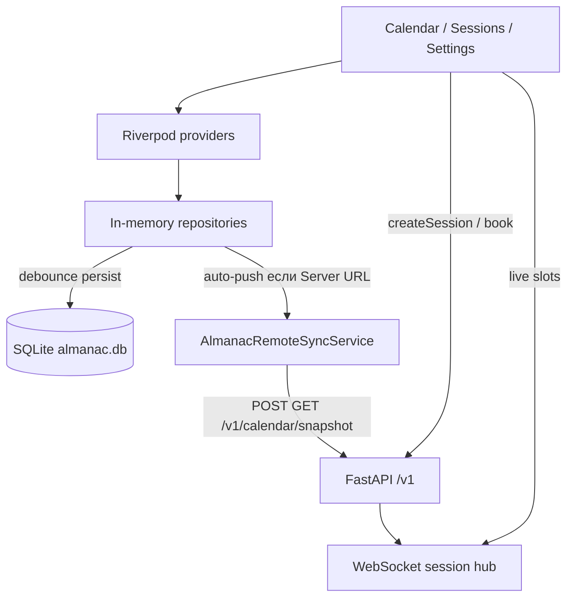

# Архитектура Almanac

Almanac — offline-first календарь на Flutter. Основной путь: локальный CRUD записей.  
Сеть нужна только для совместных профилей, сессий записи и snapshot-sync.

Входа (логин/регистрация) нет. Устройство хранит профили локально. Сервер узнаёт клиента по `X-Api-Key` и `X-Profile-Id`.

Полный перечень возможностей: [features.md](features.md). Расхождения doc↔code: [project-guide.md §11](project-guide.md#11-актуальность-документации).

## Стек

| Слой | Технологии |
|------|------------|
| UI | Flutter 3, Material 3, `go_router`, кастомные токены `AlmanacSpacing` / `AlmanacGap` |
| Состояние | Riverpod (`lib/state/`) |
| Календарный виджет | `kalender` |
| Локальные данные | SQLite (`sqlite3`) snapshot `almanac.db`; in-memory репозитории + persist |
| Повторения | пакет `rrule` |
| Сеть | `http`, `web_socket_channel` |
| Уведомления | `flutter_local_notifications` + `flutter_timezone` |
| Backend (опционально) | FastAPI 2.x, SQLite или YandexDB, WebSocket hub |
| Локализация | ru / en, `AppLocalizations` |

Клиент: Dart SDK `^3.10.7` (`pubspec.yaml`).

## Структура репозитория

```
almanac/
├── lib/
│   ├── main.dart              # bootstrap: SQLite, guards, reminders
│   ├── app/                   # AlmanacApp, тема профиля
│   ├── core/                  # theme, router, config, l10n, UI-kit, error guards
│   ├── calendar/              # экраны, виды, формы, ICS
│   ├── profiles/              # создание, свитчер, настройки, ссылки API
│   ├── sessions/              # страница сессии, создание booking/plan
│   ├── booking/               # локальные шаблоны и проекция слотов
│   ├── inbox/                 # pending заявки
│   ├── schedules/             # UI рабочих графиков
│   ├── finance/               # цели накопления, расчёт оплаты
│   ├── pomodoro/              # таймер
│   ├── notifications/         # локальные напоминания
│   ├── data/                  # репозитории, snapshot, remote sync, locks
│   ├── platform/              # REST-клиент, WS, bootstrap, config
│   └── state/                 # Riverpod providers / notifiers
├── server/                    # FastAPI: REST, WS, landing, Docker
├── test/                      # виджеты, домен, layout, platform
├── docs/                      # эта папка
└── assets/branding/           # иконка приложения
```

Точка входа: `LocalDataStore.open` → `ProviderScope` → `AlmanacApp` → `DeepLinkListener` + `PlatformBootstrap`.

## Профили и доступ

Профиль — изолированное рабочее пространство, не аккаунт.

| Kind | Роль создателя | Роль по ссылке | Сервер |
|------|----------------|----------------|--------|
| `personal` | owner | — | не используется |
| `collaborative` | owner | member | нужен; lock на правку события |
| `booking` | owner (правит слоты) | member (только запись) | нужен для удалённой сессии |

Матрица: `ProfileAccess` в `lib/data/profiles/profile_kind.dart`.

## Поток данных



1. Пользователь меняет событие в UI.
2. `EventRepository` обновляет память и помечает snapshot dirty.
3. `LocalDataStore` пишет JSON/SQLite.
4. Если у профиля задан Server URL, включены `ENABLE_REMOTE_SYNC` и auto-push — `schedulePush()` после persist (**без** debounce по умолчанию) → `POST /v1/calendar/snapshot`.
5. Конфликт: сравнение `updatedAt` (`SyncDirection` push / pull / upToDate) и диалог.

Сессии записи идут отдельным путём: REST создание + WebSocket состояние, не через snapshot календаря.

## Локальное хранилище

`LocalDataStore` держит:

- профили и активный id;
- события, расписания, цели, booking templates, group plans;
- `PlatformConfig` (URL, ключ, device id, auto push/pull);
- гостевые ICS-подписки и быстрые шаблоны;
- флаги подсказок UI и локаль.

Отдельно от snapshot: реквизиты YDB в `almanac_ydb.json` (без SA) и SA JSON в `flutter_secure_storage`.

Файл: `almanac.db` в каталоге приложения. При первом запуске возможна миграция из legacy `almanac_data.json`.

`SEED_DEMO_DATA=true` наполняет demo-событиями; по умолчанию выключено.

## Удалённый API (схема)

Базовый URL без суффикса `/v1`. Клиент дописывает пути.

```
GET  /health
GET  /v1/workspace
POST /v1/sessions
GET  /v1/sessions/:token          публично
PATCH /v1/sessions/:token/requests/:id
POST /v1/calendar/snapshot
GET  /v1/calendar/snapshot
POST /v1/calendar/locks/:eventId
WS   /v1/ws/sessions/:token
POST /v1/devices/register
GET  /join/:token                 landing → deep link
```

Подробности: [platform-api.md](platform-api.md), [self-hosted.md](self-hosted.md), схема БД сервера: `server/almanac/db/`.

## Конфигурация клиента

`AppConfig.fromEnvironment()` (`lib/core/config/app_config.dart`):

| Dart-define | По умолчанию | Смысл |
|-------------|--------------|--------|
| `SERVER_URL` | пусто | запасной origin, если в профиле не задан |
| `ENABLE_REMOTE_SYNC` | `false` | разрешить snapshot-sync |
| `ENABLE_AUTO_REMOTE_SYNC` | `true` | фоновый push после правок |
| `PUSH_DEVICE_TOKEN` | пусто | FCM token без ручного ввода |
| `SEED_DEMO_DATA` | `false` | demo-данные при пустой БД |

Server URL в UI важнее `SERVER_URL` из environment.

## Маршруты UI

См. `lib/core/router/app_router.dart` и раздел 11 в [features.md](features.md).

## Тесты и качество

- `flutter test` — домен, виджеты, layout (360 px), happy-path, скролл панелей.
- `analysis_options.yaml` — `flutter_lints` + unused import/element, const, unawaited futures.
- Нельзя менять `ErrorWidget.builder` из `AlmanacApp.build`: ломает widget tests. Guards только в `main()` (`installAlmanacErrorGuards`).
- Высокая герцовка: [perf-scroll.md](perf-scroll.md).
