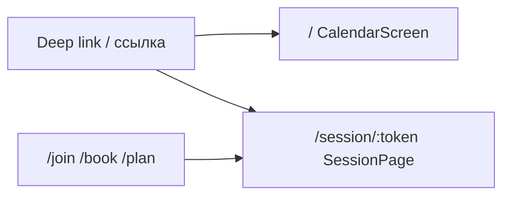

# Almanac — обзор приложения

Единый проверенный обзор: экраны, интерфейс, функции простым языком и краткий указатель для разработчиков.  
**Оглавление docs:** [README.md](README.md). **Audit doc↔code:** [audit-report.md](audit-report.md).  
Технические справочники (API, QA, spec недели) — в [docs/](README.md); см. [§12](#12-куда-смотреть-дальше).

**Последняя сверка с кодом:** 2026-10-01 (клиент `lib/`, `server/almanac`, роутер, календарь, sync).

---

## 1. О приложении

**Almanac** — календарь на Flutter: личные записи, рабочие смены, финансы, цели накопления, Pomodoro, а при подключении сервера — совместное планирование и запись на время (booking).

**Offline-first:** основные данные хранятся на устройстве в SQLite (`almanac.db`, snapshot через `LocalDataStore`). Интернет нужен не всегда: личный профиль работает полностью локально.

**Без логина и пароля.** Вместо аккаунта — **профили** (отдельные «рабочие пространства» на устройстве). Доступ к вашему серверу задаётся вручную: **Server URL**, **API Key**, **Profile ID** (лист «Ссылки и API» в настройках). Сервер узнаёт клиента по заголовкам `X-Api-Key` и `X-Profile-Id`.

**Языки интерфейса:** русский и английский (`AppLocalizations`).

---

## 2. Экраны и навигация

В приложении два полноэкранных маршрута GoRouter; остальное — bottom sheets и диалоги поверх календаря.



### Маршруты (источник: `lib/core/router/app_router.dart`)

| Путь | Экран | Назначение |
|------|--------|------------|
| `/` | `CalendarScreen` | Главный календарь |
| `/session/:token` | `SessionPage` | Запись на слот или совместное планирование |
| `/join/:token` | редирект | → `/session/:token` |
| `/book/:token` | редирект | → `/session/:token` (legacy booking) |
| `/plan/:token` | редирект | → `/session/:token` (legacy plan) |

Query-параметр **`slot`** на `/session/:token` — предвыбранный слот (`SessionPage.initialSlotId`).

### Вход по ссылке (`DeepLinkListener`, `lib/core/router/deep_link.dart`)

| Тип ссылки | Действие |
|------------|----------|
| Сессия (`/join/…`, `/book/…`, `/plan/…`, `almanac://join/…`) | Переход на `/session/:token`; опционально `?server=` для origin API |
| Workspace invite (`/connect?key=&profile=`, `almanac://connect?…`) | Подключение shared-профиля (`joinShared`), затем `/` |
| YDB invite (`parseYdbInvite`) | Подключение YandexDB workspace (`joinYdb`), затем `/` |

Подробности хостинга ссылок: [app-links.md](app-links.md).

---

## 3. Главный экран: расположение интерфейса

Файл: `lib/calendar/calendar_screen.dart`.  
Вертикальная структура внутри `SafeArea` + `ResponsiveCalendarWrapper`:

```
┌──────────────────────────────────────────────────┐
│  CalendarTopNavBar                               │
│  ◀  заголовок периода  ▶   ⚙ настройки  профиль  │
├──────────────────────────────────────────────────┤
│  CalendarToolbar                                 │
│  режим (месяц/неделя/…) · inbox · сегодня · …    │
├──────────────────────────────────────────────────┤
│                                                  │
│  Область вида (Month / Week / Agenda / Year)     │
│  горизонтальный свайп периода (с ограничениями)  │
│                                                  │
├──────────────────────────────────────────────────┤
│  CalendarCreateBar («+»)                         │
│  скрыта в режимах «месяц» и «год»                │
└──────────────────────────────────────────────────┘
```

**Фон:** градиент `AlmanacDecor.scaffoldGradient`. При загрузке/ошибке — overlay или `AlmanacErrorPanel` с «Повторить».

### Верхняя панель (`CalendarTopNavBar`)

- Стрелки **предыдущий / следующий** период (`calendarNavigationProvider`).
- **Заголовок** — месяц, неделя, повестка или год в зависимости от режима.
- **Настройки** (шестерёнка) → `SettingsSheet`.
- **Переключатель профиля** (`ProfileSwitcher`); на узкой ширине — компактный вид.

### Панель инструментов (`CalendarToolbar`)

- **Переключатель режима** календаря (`CalendarModeSwitcher`).
- **Inbox** — заявки на запись (badge с числом pending); открывает `PendingBookingsSheet`.
- В режиме **повестки** — свернуть/развернуть все дни.
- Кнопка **«Сегодня»**, если выбранный период не содержит сегодняшний день.
- **Фильтр по цвету** событий (overlay поверх toolbar).

### Центральная область

`AnimatedSwitcher` + `_CalendarActiveView` (`lib/calendar/calendar_active_view.dart`):

| `CalendarMode` | Вид | Файл |
|----------------|-----|------|
| `month` | Сетка месяца | `views/month_view.dart` |
| `week` | Неделя (wide или carousel) | `views/week_view.dart` |
| `agenda` | Список по дням | `views/agenda_view.dart` |
| `year` | 12 мини-месяцев | `views/year_view.dart` |

**Свайп периода** (`CalendarPeriodSwipeDetector`) отключён для недели в режиме **carousel** (узкий экран), чтобы не конфликтовать с горизонтальной прокруткой дней.

### Нижняя панель создания (`CalendarCreateBar`)

- Кнопка **«+»** → **CreateHub** (`CreateHubSheet` + `CreateActionPolicy`: основные типы + «Ещё параметры»).
- Видна в **month, week, agenda** (не в year).
- В профиле booking **member** подпись «Запись» (`canBookOnly`).
- На **неделе** при выбранном **слоте** подпись «Слот HH:MM – HH:MM»; время подставляется в форму.

---

## 4. Режимы календаря

### Месяц

Сетка дней, маркеры событий, статистика месяца (доход, смены и т.д. — при наличии данных). Tap по дню — выбор даты; long-press — `DayDateActionsSheet` (перейти к дню, список событий и др.).

### Неделя

Два layout в зависимости от ширины (`DateCellLayout.useWeekCarousel`):

| Условие | Режим | Поведение |
|---------|--------|-----------|
| Узкий экран: mobile (`width < 600`) **или** колонка дня `< 48 dp` | **Carousel** | Видно **3 дня**, горизонтальная прокрутка; «ghost»-колонки на краях недели |
| Иначе | **Wide** | **7 колонок** на экране |

Общее для timed-сетки:

- Часовая ось слева (overlay), all-day зона сверху колонок.
- **Пустой tap** — выбор диапазона (слот) для новой записи.
- **Событие:** tap — просмотр; удержание — **перенос** с контуром preview (слой `WeekTimedDragLayer`, контроллер `WeekMoveController`).
- **Resize** — ручки на рамке выделения; locked-смены требуют длинного удержания для «разблокировки».
- Настройки: скрыть пустые часы, zoom, отступы до/после — в `SettingsSheet` → группа «Календарь».

Детальный spec для разработчиков: [week-ui.md](week-ui.md) (часть audit может быть исторической — см. §11).

### Повестка

Вертикальный список секций по дням, snap к «сегодня», collapse секций. Перенос записи на другой день поддерживается там, где `EntryCapabilities.canDragInWeekView`.

### Год

Сетка мини-календарей (число колонок зависит от ширины `AlmanacBreakpoints.yearViewColumns`). Выбор месяца/даты возвращает в другие режимы.

---

## 5. Записи и действия

### Типы записей (`CalendarEntryKind`)

| Kind | Смысл |
|------|--------|
| `event` | Событие с временем (timed) |
| `note` | Заметка |
| `checklist` | Чек-лист |
| `savingsGoal` | Цель накопления (управление в `SavingsGoalsSheet`) |

### Откуда берутся записи (`CalendarEntrySource`)

| Source | Кратко |
|--------|--------|
| `personal` | Обычная локальная запись |
| `booking` / `bookingPending` / `bookingSlot` / `bookingOffer` | Бронирование и слоты |
| `scheduleGenerated` / `scheduleOverride` | Рабочий график и правки смены |
| `savingsGoalProjected` | Проекция цели на календарь |
| `guestCalendar` | Read-only подписка ICS |

Права на правку/удаление/перенос задаёт `EntryCapabilities` (`lib/calendar/calendar_entry_capabilities.dart`) — зависят от source, RRULE, профиля.

### Создание («+»)

1. **CreateHub** (`CreateHubSheet`, `CreateActionPolicy`) — tier-1 + «Ещё параметры».
2. Варианты: событие / заметка / чек-лист / график / цели / сессии (по роли и Server URL).
3. Записи → `CreateEventDialog`; график → `WorkScheduleSheet`.

У **booking member** (`canBookOnly`) «+» ведёт к записи на существующую сессию, а не к созданию событий.

### Просмотр и правка

- Tap по записи → **EventPreviewSheet** (week, agenda, day sheet).
- Текст/детали → «Изменить» в preview; **время на неделе** — drag-and-drop + resize.
- `EditEventDialog` — fallback для сложных случаев.
- Повторяющиеся серии (RRULE): удаление/изменение с учётом исключений (`recurrence_engine`).

### Фильтр видимости

Несколько профилей можно показывать одновременно (`visibleProfileIdsProvider`); в split-view на плитках видны имя/цвет профиля.

---

## 6. Профили, права, настройки

### Типы профилей (`ProfileKind`)

| Kind | Сервер | Owner | Member |
|------|--------|-------|--------|
| `personal` | не нужен | полный локальный календарь | — |
| `collaborative` | нужен | создаёт/правит события, inbox, sync | создаёт/правит события; locks на сервере |
| `booking` | нужен для удалённой сессии | правит календарь и слоты | **только запись** (`canBookOnly`) |

Матрица прав: класс `ProfileAccess` в `lib/data/profiles/profile_kind.dart`.

### UI профилей

- **ProfileSwitcher** — смена активного профиля.
- **ProfileManagerSheet** — переименование, удаление.
- **CreateProfileSheet** — создать personal / подключиться по API / YDB invite.

### Настройки (`SettingsSheet`)

| Группа | Содержимое |
|--------|------------|
| Профиль | список профилей, тема и акцент |
| Внешний вид | язык ru/en |
| Сервер | entry **Рабочее пространство** → `WorkspaceSheet` (sync, API, сессии) |
| Календарь | сетка недели, гостевые ICS, экспорт |
| Данные | тестовое заполнение (свёрнуто), очистка — owner |

`PlatformLinksSheet` встроен в Workspace; отдельная кнопка в sync-карточке убрана.

---

## 7. Сессии: запись и совместное планирование

**SessionPage** (`lib/sessions/session_page.dart`) — отдельный экран по token.

| `SessionMode` | Для кого | Суть |
|---------------|----------|------|
| `booking` | Владелец публикует слоты; гость записывается | Форма полей, выбор слота, заявка `pending` |
| `collaborative` | Команда согласует время | Слоты на WebSocket, presence участников |

Состояние сессии: `SessionStatus.open` / `closed`.  
Владелец подтверждает заявки через **Inbox**; после подтверждения событие попадает в календарь.

Создание сессий из календаря: `CreateBookingSessionSheet`, `CreateCollaborativeSessionSheet`; вход гостя — `JoinSessionSheet` или deep link.

---

## 8. Дополнительные возможности

| Область | Что делает пользователь |
|---------|-------------------------|
| **Рабочие графики** | RRULE по дням недели или сменный цикл N/M; override дня; быстрые действия на смене |
| **Оплата** | Ставка, overtime, НДС — сводка в статистике месяца |
| **Финансы в событии** | Сумма, подарок — учёт в месяце |
| **Цели накопления** | План суммы к дате; проекция на календарь |
| **Pomodoro** | Таймер, привязанный к записи (не для всех source) |
| **Напоминания** | Локальные уведомления до начала (`EventReminderService`) |
| **Inbox** | Pending заявки booking (локальные + с сервера) |
| **ICS** | Подписка read-only; экспорт своих событий |
| **Блокировки** | На collaborative/booking сервер держит lock при правке чужим устройством |

---

## 9. Когда нужен сервер

| Задача | Personal | Collaborative / Booking |
|--------|----------|-------------------------|
| Календарь локально | да | да (с sync) |
| Snapshot sync push/pull | нет* | да, если задан URL и `ENABLE_REMOTE_SYNC` |
| Удалённая сессия booking/plan | нет | да |
| Event locks | нет | да (collaborative/booking) |
| Inbox с сервера | нет | owner + API |

\*Sync включается глобально через `--dart-define=ENABLE_REMOTE_SYNC=true` и настройки профиля (`autoPush` / `autoPull`). После локального сохранения при включённом auto-push вызывается push (`PlatformBootstrap` → `RemoteAutoSyncScheduler.schedulePush` без задержки по умолчанию). Опрос pending на bootstrap — **каждые 10 с** (`_pendingPollInterval`).

Развёртывание API: [self-hosted.md](self-hosted.md). Контракт REST/WS: [platform-api.md](platform-api.md).

---

## 10. Для разработчиков

### Стек

| Слой | Технологии |
|------|------------|
| UI | Flutter, Material 3, `go_router`, токены `AlmanacSpacing` / `AlmanacGap` |
| State | Riverpod 2.x (`lib/state/`) |
| Календарь | Пакет `kalender` + кастомные week views |
| Локальные данные | SQLite `sqlite3`, `LocalDataStore` |
| Повторения | `rrule` |
| Сеть | `http`, `web_socket_channel` |
| Backend (опц.) | FastAPI в `server/` |

Dart SDK: `^3.10.7` (`pubspec.yaml`).

### Дерево `lib/` (сокращённо)

```
lib/
├── main.dart, app/           # bootstrap, AlmanacApp
├── core/                     # router, config, theme, l10n
├── calendar/                 # CalendarScreen, views, forms, week widgets
├── profiles/                 # switcher, settings, platform links
├── sessions/                 # SessionPage, создание сессий
├── booking/, inbox/          # проекции слотов, pending UI
├── schedules/, finance/, pomodoro/, notifications/
├── data/                     # repositories, snapshot, remote sync
├── platform/                 # REST, WS, bootstrap, mini_server
└── state/                    # Riverpod providers
```

### Точки входа UI

| Экран / поток | Файл | Ключевые providers |
|---------------|------|---------------------|
| Календарь | `calendar/calendar_screen.dart` | `calendarNavigationProvider`, `calendarEventsProvider`, `filteredCalendarEventsProvider`, `activeProfileAccessProvider` |
| Сессия | `sessions/session_page.dart` | `guestSessionServerProvider`, platform API, WS client |
| Роутинг | `core/router/app_router.dart` | `appRouterProvider` |
| Deep links | `core/router/app_router.dart` (`DeepLinkListener`) | `contextProfilesProvider`, `guestSessionServerProvider` |
| Auto sync | `platform/platform_bootstrap.dart` | `remoteAutoSyncSchedulerProvider`, `appConfigProvider` |

### Неделя: перенос событий (актуальная архитектура)

- Источники жеста: тайл / armed-рамка / тело слота — только `WeekMoveController.offer`.
- Распознавание hold: `WeekHoldMoveRecognizer` в `WeekTimedDragLayer`.
- Commit: `WeekMoveResult` → `week_view.dart` (`onMoveResult`).

---

## 11. Актуальность документации

Полный отчёт: **[audit-report.md](audit-report.md)**. Краткая выжимка drift:

| Legacy документ | Заявление / риск | Факт в коде (2026-10-01) |
|-----------------|------------------|---------------------------|
| [week-ui.md](week-ui.md) | Gap-list про `LongPressDraggable` | Timed-перенос через `WeekTimedDragLayer` + `WeekHoldMoveRecognizer` |
| [features.md](features.md) | Перенос: `week_carousel_unified.dart` | Commit/preview: `WeekMoveController`, слой на unified **и** `week_events_drop_grid` |
| [architecture.md](architecture.md) / [features.md](features.md) | Auto-sync debounce ~5 с | `schedulePush()` по умолчанию **без** delay (`Duration.zero`) после persist |
| [features.md](features.md) | Inbox опрос ~45 с | `PlatformBootstrap`: `_pendingPollInterval = 10` с |
| [features.md](features.md) | Deep link только `almanac://join` | Также `almanac://connect`, HTTPS `/connect`, YDB invite (`parseYdbInvite`) |

**2026-10-01:** строки выше исправлены в `architecture.md`, `features.md`, `week-ui.md`, `qa-checklist.md`, `self-hosted.md`; hub — [README.md](README.md).

**Роли файлов в `docs/` после audit:**

| Файл | Роль |
|------|------|
| **project-guide.md** (этот) | Главный обзор продукта и UI |
| [architecture.md](architecture.md) | Стек, поток данных, папки |
| [features.md](features.md) | Детальный реестр функций (проверять по §11) |
| [week-ui.md](week-ui.md) | Spec недели для разработчиков |
| [platform-api.md](platform-api.md) | REST / WebSocket |
| [self-hosted.md](self-hosted.md) | Деплой сервера |
| [app-links.md](app-links.md) | OS deep links |
| [infoDB.md](infoDB.md) | Данные и API кратко |
| [perf-scroll.md](perf-scroll.md) | 90/120 Hz, scroll |
| [qa-checklist.md](qa-checklist.md) | Ручной QA |

Опционально позже: точечные правки legacy-файлов по мере изменений кода.

---

## 12. Куда смотреть дальше

- **Оглавление docs:** [README.md](README.md)
- **Audit doc↔code:** [audit-report.md](audit-report.md)
- Реестр всех функций с путями к файлам: [features.md](features.md)
- Архитектура и sync-flow: [architecture.md](architecture.md)
- API сервера: [platform-api.md](platform-api.md)
- Чек-лист тестирования: [qa-checklist.md](qa-checklist.md)
